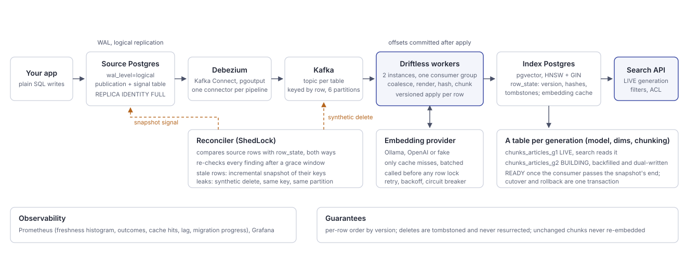
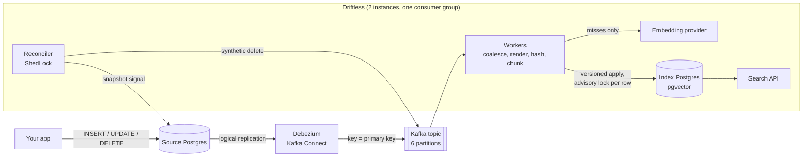

# Driftless

Driftless keeps a vector search index in step with the Postgres tables it was built from. Every insert,
update and delete in a source table reaches a pgvector index within about a second, through change data
capture. The application writing the table doesn't change. You can also re-embed a whole table with a new
model while search keeps serving the old index, then swap atomically.

Most retrieval setups embed their data once with a batch job. Then the source moves on: a price is edited,
a document is deleted (maybe for a GDPR request), someone loses access. The index keeps serving the old
text, or text that should be gone. Re-embedding everything nightly is slow and expensive, and leaves the
index up to a day stale. Driftless does the incremental version, and it's built so that the hard cases
come out right: deletes during a backfill, redelivered or reordered events, crashes halfway through a
migration, and rows whose access was revoked.

Java 21 · Spring Boot 4 · Debezium 3.7 · Kafka 4.1 · PostgreSQL 17 + pgvector · Ollama / OpenAI · Flyway · Testcontainers · Prometheus/Grafana

## What it guarantees

- **Per-row order.** Every change carries a version taken from the source's WAL position, and a change is
  applied only if it's newer than what's stored for that row. Redelivery, rebalances, replays and snapshot
  reads can't move a row backwards ([ADR 1](docs/adr/0001-row-versions.md)).
- **Deletes stick.** A delete removes every chunk of the row and leaves a tombstone, so a late, older
  event can't bring the row back, including during a migration.
- **Access revocation isn't held back by the embedder.** Metadata changes (such as `acl`) and deletes
  never call the embedding provider. When a text change can't be embedded, its metadata still applies.
- **No wasted embedding calls.** Chunks are cached by (model, content hash), so an edit re-embeds only
  the chunks whose text changed. A change that touches no embedded column (`updated_at`, say) is a no-op,
  and several changes to one row in a batch collapse into one.
- **Zero-downtime migration.** A new model, dimension or chunking setting builds a new generation beside
  the live one. Cutover and rollback are single transactions.
- **Drift is detected and repaired.** A reconciler compares source and index in both directions,
  re-checks before reporting, and repairs through the same stream as everything else.

At-least-once delivery plus idempotent apply is the model; there is no exactly-once machinery.

## Architecture





1. **Capture.** Debezium streams each configured table to its own Kafka topic, keyed by primary key, so
   every change to a row lands on the same partition.
2. **Prepare.** A worker takes a batch, keeps only the newest version per row, renders the text template,
   hashes text and metadata, and classifies each change against the stored row state: `STALE`, `SKIP`,
   `METADATA_ONLY`, `DELETE` or `EMBED`.
3. **Embed.** Chunks are looked up in the embedding cache, and only the misses go to the provider, in batches.
   This happens before any lock is taken, so a slow model never holds the database.
4. **Apply.** One short transaction per row and generation takes an advisory lock, re-classifies (a newer
   change may have landed meanwhile), writes the chunks and the row state, and drops leftover chunks.
5. **Commit.** Kafka offsets are committed only after the whole batch is applied or recorded as a failed
   change. A provider outage retries the batch with the partition paused. Order is kept, and nothing is skipped.

**One stream for everything.** The initial backfill, a migration's re-read and repair of drifted rows are
Debezium *incremental snapshots*, requested through a signal table. Their reads arrive on the same topic as
live changes, merged by Debezium's watermarking, and go through the same apply code. There's no separate
bulk path where an old read could overwrite a newer change ([ADR 2](docs/adr/0002-one-change-stream.md)).

## Ordering

The version is `(lastCommitLsn, lsn)` from Debezium's `source.sequence`, not the change's own LSN. Snapshot
reads have no LSN, and change LSNs are assigned when a statement runs, not when its transaction commits.
`VersionOrderingIT` checks that the version is monotonic per row: four writers run multi-statement transactions
on 50 hot keys, alongside two incremental snapshots and a connector restart. A naive LSN version fails it
immediately. The details are in [ADR 1](docs/adr/0001-row-versions.md).

## Migration

Changing the model, dimensions, template, chunking or metadata columns in config doesn't touch the live
index. The pipeline reports that its config differs from the live generation, and you start a migration:

```bash
curl -X POST localhost:8180/v1/pipelines/articles/migrations -H "Authorization: Bearer $TOKEN"
```

1. Generation n+1 is created as `BUILDING`, in its own table, `chunks_articles_g2`. A table per generation
   lets dimensions differ, and dropping one is instant ([ADR 3](docs/adr/0003-table-per-generation.md)).
2. Live changes are written to both generations from that moment, and a full incremental snapshot
   backfills the new one.
3. The new generation becomes `READY` once the consumer group's committed offsets pass the topic's end
   offsets recorded when the snapshot completed. A completion notice alone would race the last reads
   ([ADR 4](docs/adr/0004-ready-waits-for-consumer-offsets.md)).
4. `cutover` makes it `LIVE` and the old one `DRAINING`, in one transaction. The old generation keeps
   receiving writes, so `rollback` is exact. `finalize` drops it.

Search reads only the `LIVE` generation throughout. A crash during the backfill needs no special recovery:
Debezium resumes the snapshot from its offsets, and the apply is idempotent.

## Reconciler

A scheduled job compares source rows with the index's row state for the live generation, in both directions:

- **Missing or stale:** the source row isn't indexed, or its text or metadata hash differs. These are repaired by an
  incremental snapshot of those keys.
- **Leaked:** the row is gone from the source but still searchable. A snapshot can't read a row that doesn't exist,
  so the repair publishes a synthetic Debezium delete onto the pipeline's own topic. It uses the same key bytes, so
  it lands on the same partition behind anything in flight. Its version sits just after the last applied one, so a
  re-insert committed meanwhile still wins ([ADR 5](docs/adr/0005-leak-repair-by-synthetic-delete.md)).

Every finding is re-checked after a grace window, and it's reported only if the source is unchanged and
the index still disagrees. A change that reaches the index within that window is never reported. One delayed
longer, by a consumer backlog or a provider outage, can be reported as drift. Repairing it does no harm, because
the versioned apply drops whatever is older, so the cost is a noisy report. Repair runs automatically or on request (`POST /v1/drift-reports/{id}/repair`).

The demo profile has chaos endpoints that corrupt and leak index rows on purpose, so you can watch this happen.

## Measured

All on one laptop: Apple M4, 10 cores, 16 GB. Both Postgres instances, Kafka, Connect, two Driftless
instances and Prometheus run in Docker (OrbStack), and Ollama runs natively. Freshness runs from the source
commit to the commit of the index transaction.

| Scenario | Result |
|---|---|
| Pipeline throughput, fake embedder (0 ms), balanced write mix | **600 changes/s** with every change searchable within 2 s. At 800/s it falls behind: only 11% landed within 2 s. |
| Realistic mix at 10 changes/s, embedded by `nomic-embed-text` | Freshness **p50 604 ms, p99 1,050 ms**. 43% of changes needed no embedding (`updated_at` touches and ACL edits), and 218 chunks came from the cache, against 434 sent to Ollama. |
| Migration `nomic-embed-text` → `mxbai-embed-large` (about 4,600 rows) under 5 writes/s and a search every 200 ms | `READY` after 1,572 s. **0 search errors** in 4,922 searches, search p99 179 ms. After the backlog drained, the index matched the source exactly: 0 leaked, 0 missing, and the reconciler was clean over the whole table. |

**Known limit: a migration on a slow model delays live changes.** Backfill reads and live changes share
the topic's partitions, which is what keeps them ordered. So while a local model works through the
backfill, live changes queue behind it in both generations. In the migration run, 7,549 changes were
queued when the new generation became `READY`, and the queue took 500 s to clear after writes stopped.
Correctness held throughout, but freshness during that migration was minutes, not seconds, and that
includes deletes and ACL revocations, which wait in the same queue. (When the provider is down rather than
slow, they don't wait: changes that need no embedding are applied first.) A faster
model or a hosted provider shortens this. Fixing it properly means either throttling the backfill or
giving it a lower priority than live changes, and neither is built.

The full results, with every raw number, are in [docs/loadtest](docs/loadtest/). To reproduce them, run
`./scripts/loadtest.sh`.

## Running it

Requires Docker with Compose, Java 21, `curl`, `jq`, and [Ollama](https://ollama.com) running on the host.
Docker on macOS has no GPU access, so the models run natively.

```bash
ollama pull nomic-embed-text && ollama pull mxbai-embed-large
cp .env.example .env
docker compose up -d --build   # source and index Postgres, Kafka, Connect, 2 Driftless instances, Prometheus, Grafana
./scripts/seed.sh              # 5,000 Ask Ubuntu questions into the source table; waits until indexed
./scripts/demo.sh              # search, edit, delete, migrate to mxbai-embed-large, break the index and repair it
```

| What | Where |
|---|---|
| API (instance 1 / 2) | http://localhost:8180, http://localhost:8181 |
| OpenAPI document | http://localhost:8180/v3/api-docs |
| Grafana (anonymous) | http://localhost:3002 |
| Prometheus | http://localhost:9091 |
| Kafka Connect | http://localhost:8083 |
| Source / index Postgres | localhost:5443 / localhost:5444 (credentials in `.env`) |

A pipeline is config:

```yaml
driftless:
  pipelines:
    - name: articles
      table: public.articles
      key: id                          # single-column primary key
      text: "{title}\n\n{body}"        # what gets embedded
      metadata: [category, tenant_id, acl]   # stored as jsonb, filterable, never embedded
      embedding: { provider: ollama, model: nomic-embed-text, dimensions: 768 }
      chunking: { max-chars: 2000, overlap-chars: 200 }
```

At startup Driftless checks the source table (logical WAL, publication, signal table, `REPLICA IDENTITY
FULL`), registers the pipeline's Debezium connector, and backfills it. A table that fails a check
blocks only its own pipeline, and the reason is reported.

## API

All `/v1` routes take `Authorization: Bearer <admin token>`. Errors are RFC 9457 `application/problem+json`,
and lists are cursor-paginated (`?limit=&cursor=`).

| Area | Routes |
|---|---|
| Pipelines | `GET /v1/pipelines`, `GET /v1/pipelines/{name}` (status, lag, counts, freshness, savings, migration), `GET …/{name}/changes`, `GET …/{name}/snapshots` |
| Search | `POST /v1/pipelines/{name}/search` `{query, k, filter, principal}` |
| Migrations | `POST /v1/pipelines/{name}/migrations`, `…/migrations/cutover`, `…/rollback`, `…/finalize` |
| Drift | `POST /v1/pipelines/{name}/reconcile`, `GET …/{name}/drift-reports`, `GET /v1/drift-reports/{id}`, `POST /v1/drift-reports/{id}/repair` |
| Failed changes | `GET /v1/pipelines/{name}/failed-changes`, `POST /v1/failed-changes/{id}/retry` |

```bash
curl -X POST localhost:8180/v1/pipelines/articles/search -H "Authorization: Bearer $TOKEN" \
  -H 'Content-Type: application/json' \
  -d '{"query": "How do I change my password?", "k": 3, "filter": {"tenant_id": "acme"}, "principal": "staff"}'
```

Search uses pgvector's iterative HNSW scan, so a selective tenant or ACL filter still returns k results.
`principal` returns only chunks whose `acl` contains it.

## Tests

The suite has 169 tests: 75 unit tests (71 in the server, 4 in the load generator) and 94 integration tests. The integration tests run against Postgres, Kafka and Debezium in Testcontainers, with WireMock standing in for
the embedding providers. The ones that carry the guarantees:

- `VersionOrderingIT`: per-row versions are monotonic under concurrent transactions, snapshots and a connector restart.
- `ConvergenceIT`: random concurrent writers, redelivery and snapshots; afterwards the index matches the source exactly. A second case runs across a `TRUNCATE`.
- `MigrationServiceIT`: migration under live writes, with search checked every 200 ms; a delete during the backfill is never resurrected; a crash halfway resumes; `READY` waits for the consumer; rollback and finalize.
- `ReconcilerIT` and `LeakRepairIT`: drift found and repaired; a row re-inserted during leak repair survives.
- `ChangeApplierIT`: stale and out-of-order versions, no resurrection after a delete, orphan chunks removed, ACL-only changes without the embedder, a render failure that still applies the ACL, and truncate ordering.

```bash
./mvnw verify    # needs Docker
```

## Decisions

1. [Row versions come from Debezium's `source.sequence`](docs/adr/0001-row-versions.md)
2. [One change stream for live changes, backfill, migration and repair](docs/adr/0002-one-change-stream.md)
3. [One chunk table per index generation](docs/adr/0003-table-per-generation.md)
4. [A migration is READY only when the consumer has passed the snapshot's end](docs/adr/0004-ready-waits-for-consumer-offsets.md)
5. [Leaks are repaired by a synthetic delete published onto the change topic](docs/adr/0005-leak-repair-by-synthetic-delete.md)

## Not in scope

- Generating answers. Driftless keeps retrieval correct; the search API exists so you can see the result.
- Sources other than Postgres, and vector stores other than pgvector.
- Composite primary keys.
- Multi-tenant hosting, users or billing. One admin token guards the API.
- Exactly-once processing.

## Demo data

The demo dataset is 5,000 questions from [Ask Ubuntu](https://askubuntu.com), each with its accepted answer,
fetched through the public Stack Exchange API by `ops/demo-data/fetch.sh`. The content is written by Ask Ubuntu
users and licensed [CC BY-SA](https://stackoverflow.com/help/licensing) (2.5, 3.0 or 4.0, depending on when each post was
written). Each record keeps the link to its question for attribution. The data isn't committed; `seed.sh`
downloads it.
